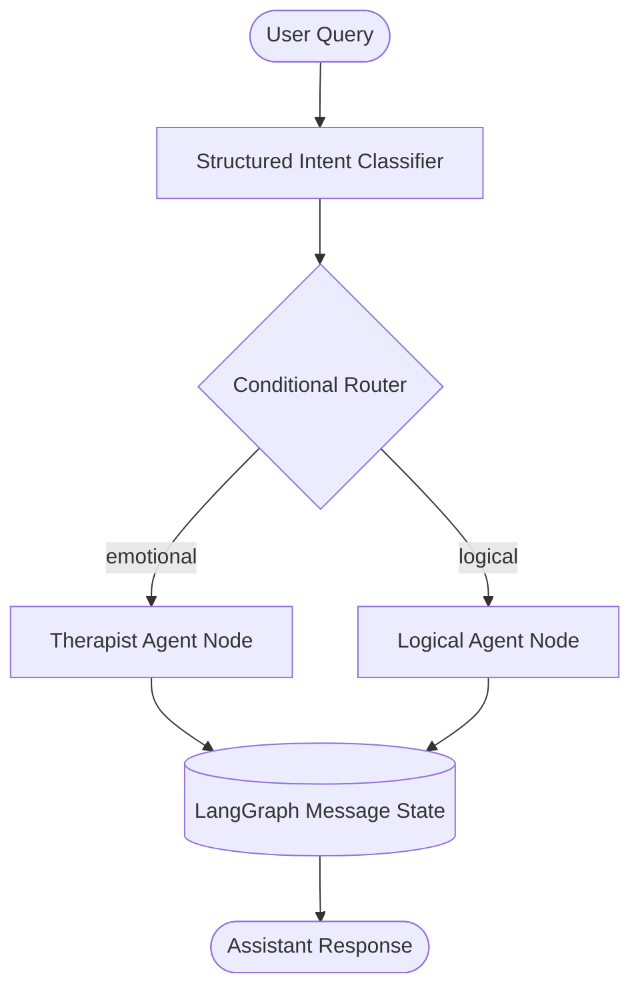

# MindRouter-Agent 🤖

<p align="center">
  
  
  
  
  
</p>

**MindRouter-Agent** is a multi-agent conversational router built with **LangGraph**, **LangChain**, and **GPT-4o-mini**. It classifies incoming user intent using structured Pydantic output (`MessageClassifier`) and routes the conversation history between two specialized persona nodes: **Therapist Agent** (empathetic support) and **Logical Agent** (analytical problem-solving).

---

## 🏗️ Multi-Agent Architecture



---

## 🛠️ Project Structure

```
mindRouter-agent/
├── main.py              # Core LangGraph state machine, classifier, and persona nodes
├── streamlit_app.py     # Interactive Streamlit web interface
├── pyproject.toml       # Package metadata & dependencies
├── requirements.txt     # Python dependencies
├── .env.example         # Environment configuration template
└── README.md            # Project documentation
```

---

## 📦 Quick Start

### 1. Clone Repository

```bash
git clone https://github.com/alhaj-ai/mindRouter-agent.git
cd mindRouter-agent
```

### 2. Install Dependencies

```bash
python -m venv venv
venv\Scripts\activate
pip install -r requirements.txt
```

### 3. Configure API Key

```bash
cp .env.example .env
# Set OPENAI_API_KEY=your_openai_api_key_here
```

### 4. Run Application

#### Option A: Streamlit Web UI
```bash
streamlit run streamlit_app.py
```

#### Option B: Terminal CLI Mode
```bash
python main.py
```

---

## 📄 License & Attribution

Open-source under the **MIT License**. Developed by **[Mohammed Al-Haj](https://github.com/alhaj-ai)**.
